# RMLDNet — Lane Perception and Experiment Management

**Developed and maintained by Muhammad Awais Ashraf — Software Engineer and Researcher.**

RMLDNet is a Python platform for camera-based lane segmentation, visibility restoration, temporal lane tracking, and reproducible computational experiments. It connects neural perception models with a transactional experiment registry, verified dataset preparation, statistical analysis, and traceable result artifacts.

[](pyproject.toml)
[](LICENSE)
[](CHANGELOG.md)

## Overview and objectives

Thin lane markings are difficult to segment consistently when contrast changes, markings are interrupted, or frames contain occlusions. Reliable experimentation also requires correct labels, isolated splits, consistent evaluation, and recoverable records. RMLDNet addresses both the perception problem and the engineering needed to investigate it.

The project provides:

- Atmospheric transmission and airlight estimation for learned visibility restoration.
- Hierarchical shifted-window Swin encoders, top-down feature pyramids, binary segmentation, and instance embeddings.
- Image-coordinate lane geometry, gated association, and Kalman prediction/update for instance-supervised sequences.
- A U-Net baseline and independently trainable compact/no-defogging variants.
- Verified public dataset downloading, annotation conversion, augmentation, and deterministic split preparation.
- SQLite storage with relational constraints, atomic ingestion, read-only queries, portable exports, and online backup/recovery.
- Measured comparison tables, group-bootstrap uncertainty, threshold/fog sensitivity, and exportable figures.

The system is intended for research and engineering evaluation. It has not been validated for safety-critical vehicle control.

## Measured results

The executed study uses **VIA / GGDataSet camera images of a miniature physical driving track**. It uses 256 training images, 64 model-selection validation images, and 610 held-out test images after exact duplicate removal. Each condition is evaluated at 96×224 pixels. Semantic masks do not identify separate lane instances, so instance supervision and tracking scores are excluded from this study.

| Model | Original pixel F1 (%) | Synthetic fog β=0.7 | Synthetic fog β=1.2 |
|---|---:|---:|---:|
| Full Swin-B | **82.34** | **82.17** | **81.66** |
| U-Net baseline | 80.94 | 81.76 | 81.03 |
| Compact Swin + restoration | 77.54 | 77.80 | 75.39 |
| Compact Swin without restoration | 77.06 | 77.90 | 75.87 |

Full Swin-B was fine-tuned for 3 epochs from verified ImageNet-1K weights. Compact variants and U-Net were trained for 20 epochs from random initialization; restoration-enabled variants additionally received 2 epochs of paired synthetic restoration pretraining. Budgets and initialization differ. These single-seed measurements do not establish statistical superiority. The compact restoration ablation did not show a consistent fog-condition benefit.

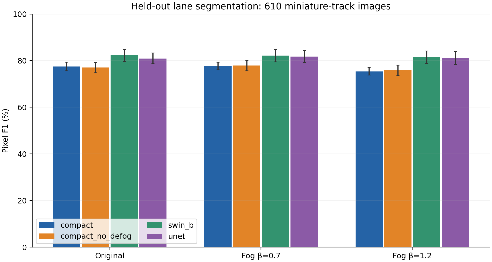

*Figure 1. Measured held-out pixel F1 with 95% percentile intervals obtained by resampling source filename groups. These groups approximate local temporal blocks and are not verified independent drives.*

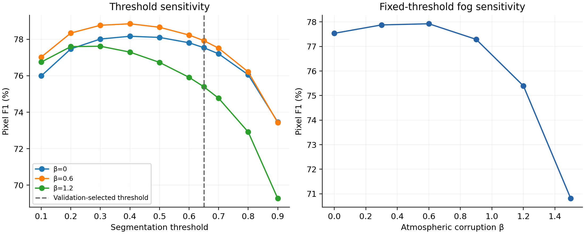

*Figure 2. Actual compact-checkpoint sensitivity to segmentation threshold and synthetic atmospheric corruption. The dashed threshold was selected using validation data; the test sweep is descriptive and does not retune the model.*

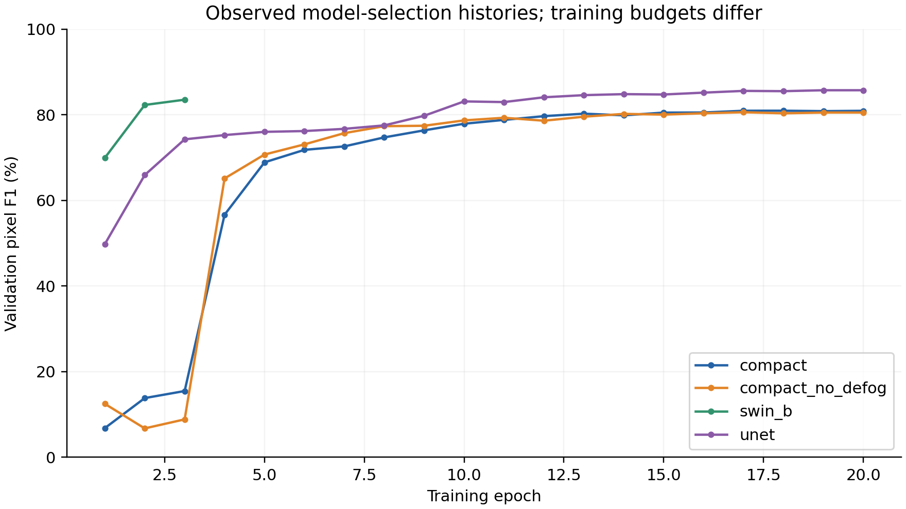

*Figure 3. Recorded validation F1 during training. Different epoch budgets and initialization are shown explicitly.*


*Figure 4. The first six held-out examples in deterministic order. Columns show reference lane masks, predictions, and errors: green true positives, red false negatives, blue false positives. Source photographs are excluded.*

Full numeric results, confusion matrices, and per-image observations are in [results/via](results/via/README.md). Statistical records and sensitivity sweeps are in [results/analysis](results/analysis/README.md). Vector SVG and PDF figures are available alongside the PNG versions in [results/figures](results/figures).

## Additional computational experiments (v0.4.0)

Six new experiment groups add seven figures, with full outputs in [the extended results report](results/extensions/README.md). Original segmentation results and earlier figures remain unchanged. Numerical trajectory studies are explicitly synthetic; real-image diagnostics use the same 610 held-out miniature-track images.

### Synthetic filtering and temporal stress

A reusable linear Kalman kernel and a two-anchor constant-velocity wrapper now expose prediction, correction, control inputs, missing/partial measurements, innovation gates, Joseph covariance updates, stable initialization and lost-track reacquisition. On separate verification noise seeds 207–226, nominal observed-frame RMSE is **0.011947 raw → 0.004861 filtered**. With dropout/outlier stress it is **0.034545 → 0.005510**, in normalized image width. These are simulated measurement trajectories, not road-video accuracy scores.

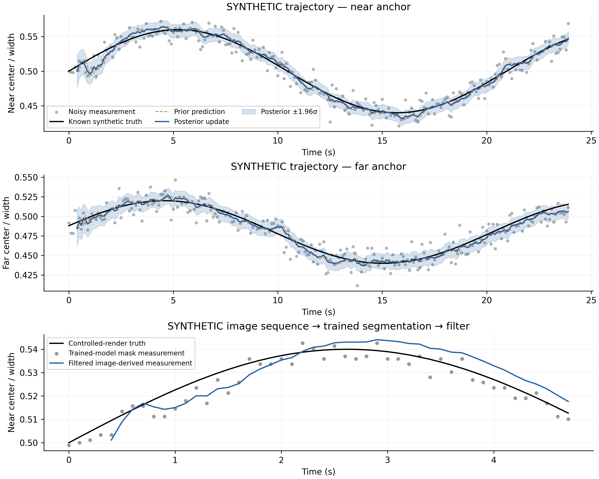

*New figure 1. Known synthetic trajectories, raw observations, prior predictions, posterior estimates and model-based uncertainty. The third panel runs the delivered segmentation model on a controlled rendered sequence before measurement extraction and filtering. Startup estimates are withheld until a stable five-observation window is available.*

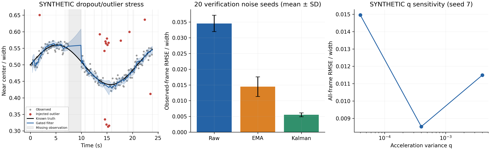

*New figure 2. Dropout/outlier stress, observed-frame RMSE distributions across verification noise seeds, and a process-noise sensitivity check. Initial gating failures and an intermediate startup failure are retained and explained in the report; they were not discarded from the investigation.*

### Extended fog and restoration comparison

Three frozen checkpoints were evaluated at new atmospheric β levels 0.15, 0.45, 1.8 and 2.1. The original-image condition was replayed and reproduced all three original confusion matrices exactly. Thresholds remain validation-selected.

| Model | β=0.15 F1 (%) | β=0.45 | β=1.8 | β=2.1 |
|---|---:|---:|---:|---:|
| compact | 77.73 | 77.95 | 61.31 | 49.12 |
| compact_no_defog | 77.41 | 77.85 | 61.17 | 51.25 |
| unet | 81.37 | 81.82 | 74.18 | 66.09 |

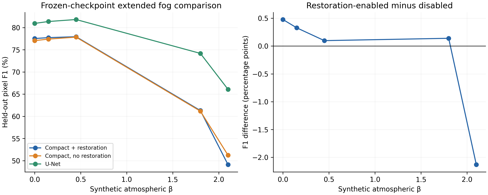

*New figure 3. Held-out performance under additional controlled fog levels and restoration-enabled minus disabled differences. Severe fog substantially degrades all three models. Restoration does not consistently help; differing original training histories prevent a causal claim from this comparison.*

### Controlled computational efficiency

Fresh subprocesses benchmark all four trained models serially using the same SHA-256-verified 96×224 synthetic RGB probe, batch 1, two Torch threads, five warmups and 3×30 forwards. Raw timings and sampled total process RSS are retained. These are network-only CPU measurements, not end-to-end vehicle-system speed.

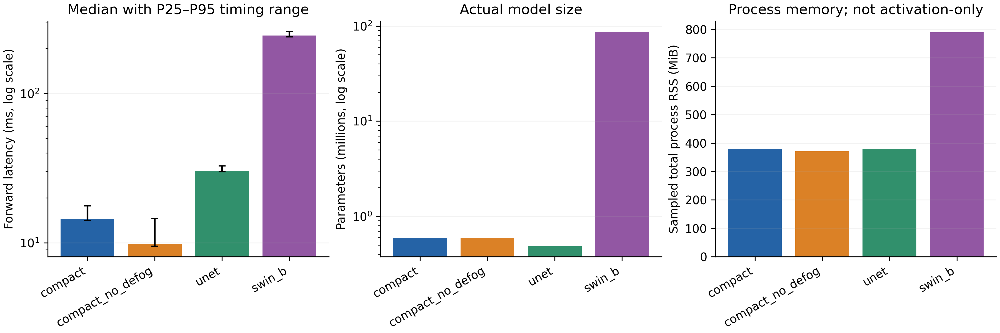

*New figure 4. Median/P25–P95 forward timings, actual parameter counts, and sampled total resident memory. RSS includes the runtime and model and is not activation-only memory.*

### Confidence, uncertainty and failure cases

New analyses calculate Brier error, negative log-likelihood, decision-calibration ECE, and predictive Bernoulli entropy. Class-conditional Brier scores expose lane/background imbalance. Predictive entropy is not epistemic uncertainty and cannot identify every confident error.

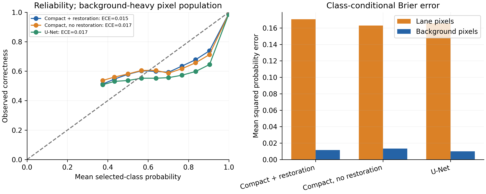

*New figure 5. Selected-class reliability and lane/background probability errors for the frozen original-image predictions. Background dominates the population, so aggregate calibration alone is insufficient.*

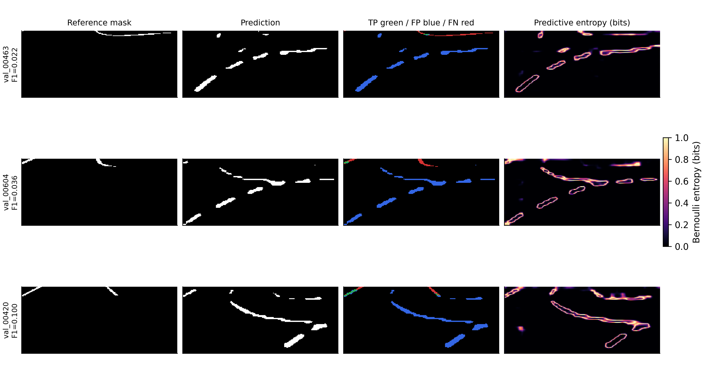

*New figure 6. The compact model’s three lowest finite per-image F1 cases, with reference masks, predictions, false-positive/false-negative maps and entropy. The selection rule and example IDs are published; these are deliberately difficult cases, not representative averages.*

### Lane geometry and measurement availability

Near/far row-band measurements estimate a corridor center only when markings bracket the image center. For compact Swin, near-anchor MAE is **2.129 pixels on 56/610 paired-valid images**; far-anchor MAE is **0.771 pixels on 166/610 images**. The reference extractor itself succeeds on only 64 near and 178 far images. These are coverage-limited mask-consistency measurements, not calibrated vehicle localization.

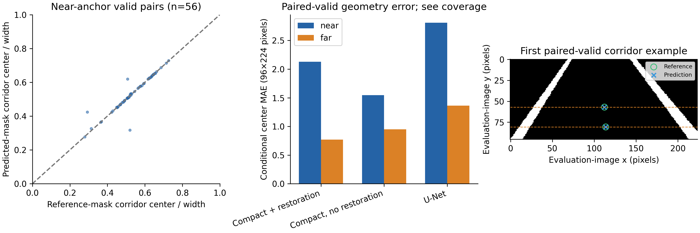

*New figure 7. Paired mask-derived center scatter, conditional MAE, and a deterministic measurement example. Missing geometry is not filled using reference annotations. Report availability together with error.*

### Reproduce the additions

```bash
python -m rmldnet.extensions all --output runs/extensions --full-checkpoint runs/via/swin_b/best.pt
python -m rmldnet.temporal --render-demo --output runs/controlled_sequence
```

The full Swin-B checkpoint must first be generated using the existing training instructions. Independent stages and input sequence requirements are documented in [additional experiments](docs/additional_experiments.md) and [Kalman mathematics and configuration](docs/kalman_filter.md). Generated working outputs remain under `runs/`.

## System architecture


The perception pipeline and experiment-management pipeline can be used independently. Raw images remain in dataset directories; the registry stores metadata, sample references, hashes, configurations, measured counts, and artifact references.

## Algorithms and computational methods

Visibility restoration uses `I = Jt + A(1−t)`, with learned transmission `t ≥ 0.1` and airlight `A`. The restored image is `J = clip((I−A)/t + A, 0, 1)`. A four-stage Swin encoder generates features at strides 4, 8, 16, and 32. Lateral projections and top-down interpolation combine semantic context with fine spatial information. Depthwise separable heads predict lane logits and embeddings.

Training uses `(BCE + Dice) + 0.5 L_instance + 0.5 L_soft-IoU`. For semantic-only labels, `L_instance` is explicitly disabled. Discriminative instance loss uses within-lane compactness and separation between lane centers. Binary metrics are calculated from integer pixel confusion matrices, including precision, recall, F1, accuracy, lane IoU, and two-class mIoU.

The temporal module fits normalized image-coordinate cubic curves and maintains offset, heading, curvature-proxy, and curvature-change-proxy states. Gated Hungarian matching associates detections; a Joseph-form covariance update helps preserve numerical stability. State proxies are not calibrated physical roadway curvature.

See [methodology](docs/methodology.md) for equations, parameters, and scientific assumptions, and [architecture](docs/architecture.md) for module boundaries.

## Explicit Kalman filtering workflow

The new semantic sequence state is `x=[near_center,far_center,near_velocity,far_velocity]`, using normalized image width and seconds. It complements the existing individual-lane cubic tracker. Initialization requires five coherent complete measurements; subsequent partial or missing observations are supported. Q/R, covariance validation, innovation gating and recovery behavior are configurable in `configs/temporal.yaml`.

$$\hat x^-_k=F_k\hat x_{k-1}+B_ku_k,\qquad P^-_k=F_kP_{k-1}F_k^T+Q_k.$$

$$K_k=P^-_kH_k^T(H_kP^-_kH_k^T+R_k)^{-1},\qquad \hat x_k=\hat x^-_k+K_k(z_k-H_k\hat x^-_k).$$

$$P_k=(I-K_kH_k)P^-_k(I-K_kH_k)^T+K_kR_kK_k^T.$$

Linear solves replace explicit inversion. The last equation is the Joseph covariance update. Full matrix definitions, units, initialization, validation, reacquisition and numerical tests are explained in [the Kalman guide](docs/kalman_filter.md).

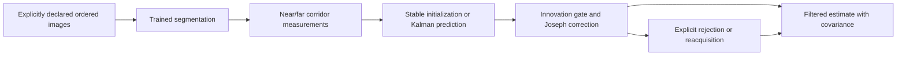

Use `verified_video` only when temporal provenance is known; otherwise use the controlled synthetic renderer. Standard VIA image manifests are rejected by the sequence command. The default initializer adds at least 0.4 seconds of latency at 10 Hz, and incomplete geometry may leave the filter uninitialized.

## Database architecture

SQLite is suitable for local and single-workstation experiments: it provides ACID transactions, foreign keys, portable files, SQL views, and consistent online backups without a separate server. It is not configured as a distributed multi-writer service.

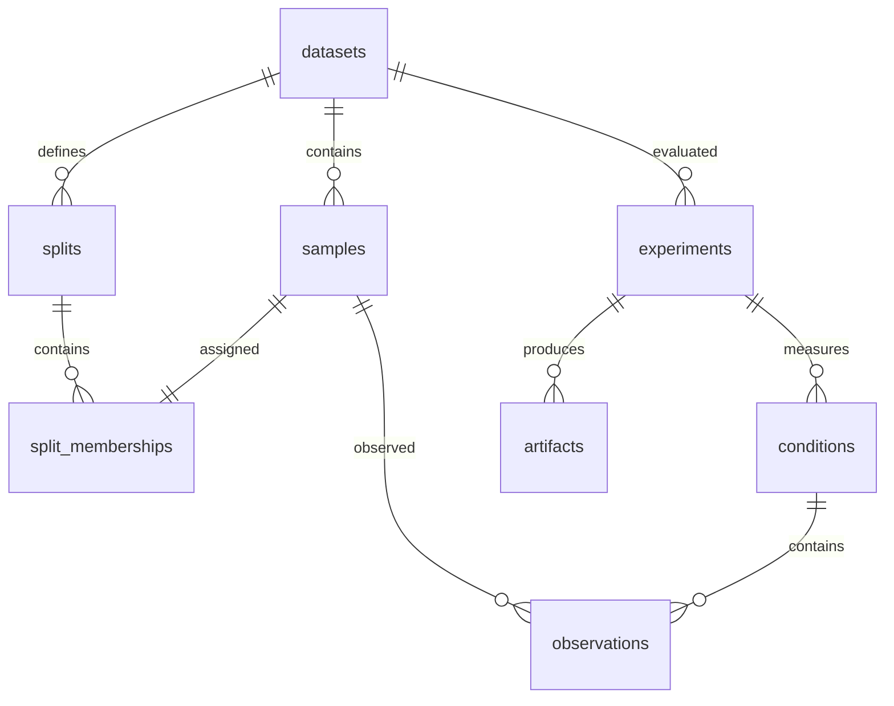

The registry enforces unique sample content, disjoint split membership, nonnegative integer confusion counts, unique experiment-condition identities, and valid cross-table relationships. Ingestion validates all input files before opening a write transaction. Per-image counts must reconcile exactly with aggregate counts. An SQL view computes metrics from stored counts rather than trusting redundant scores.

## Requirements and installation

Tested environment: Python 3.12.14, CPU PyTorch 2.5.1, torchvision 0.20.1, NumPy 2.1.3, SciPy 1.14.1, SQLite, and Matplotlib 3.9.2. A GPU is optional for the platform and recommended for large training runs.

```bash
git clone https://github.com/mawaisashraf3/ITS-2026.git
cd ITS-2026
python3.12 -m venv .venv
source .venv/bin/activate
pip install torch==2.5.1 torchvision==0.20.1 --index-url https://download.pytorch.org/whl/cpu
pip install -r requirements-cpu-lock.txt
pip install -e . --no-build-isolation
python -m pytest -q
```

For GPU training, use the appropriate official CUDA PyTorch wheels and `requirements.txt` rather than the CPU-specific lock file. No external weights are downloaded implicitly by model constructors.

## Configuration and environment

`configs/platform.yaml` configures the database, result bundle, output directory, dataset path, random seed, and bootstrap replicate count. Paths are relative to the working directory; commands below run from the repository root. `RMLDNET_DB` can override the database path. Configuration rejects unknown keys and invalid reproducibility settings.

- `configs/smoke.yaml`: small synthetic software checks.
- `configs/full.yaml`: full Swin-B at 320×800, 100 epochs, batch 8.
- `configs/full_50.yaml`: corresponding 50-epoch configuration.
- `configs/platform.yaml`: database and analysis workflow.

Full-resolution configurations are available for further experiments; their large-scale training results are not claimed here.

## Run the complete management workflow

The delivered results can be ingested and analyzed without downloading source images:

```bash
python -m rmldnet.pipeline
```

To repeat the measured sensitivity sweep and regenerate all figure formats, first prepare the source dataset, then run:

```bash
python -m rmldnet.public_data --download --output data/via
python -m rmldnet.pipeline --with-sensitivity
```

The pipeline validates results, imports them transactionally, checks database integrity, recomputes statistical intervals, and writes a machine-readable report under `runs/platform_report`. Repeated imports are idempotent.

## Dataset acquisition and preparation

The downloader obtains the public VIA segmentation release and verifies its pinned SHA-256. It ignores executable code and external models bundled in the archive. Source RGB masks use `(192,128,128)` for lane markings. The release contains 5,074 training and 1,157 validation frame files; 1,311 exact-byte duplicates are removed before selecting the experiment splits. The deduplicated original validation data serve as the held-out test set. Model-selection validation uses separate 100-index filename blocks from original training data.

The source lacks verified video identifiers, so block-based separation cannot establish independence between drives. The data represent miniature physical-track scenes, not full-size roads or real fog. See [data protocols](docs/DATA.md), [release provenance](results/via/dataset_provenance.json), and [third-party notices](THIRD_PARTY_NOTICES.md).

TuSimple, CULane, and BDD100K converters are also included:

```bash
python -m rmldnet.prepare tusimple --annotations /datasets/train.jsonl --images /datasets/tusimple --output data/tusimple/train
python -m rmldnet.prepare culane --annotations /datasets/CULane/list/train_gt.txt --images /datasets/CULane --output data/culane/train
python -m rmldnet.prepare bdd100k --annotations /datasets/bdd/lane_train.json --images /datasets/bdd/train --output data/bdd/train
```

Their native official evaluation protocols are separate from the binary pixel metrics used in this repository. Obtain each dataset under its own terms; do not infer benchmark results from conversion support.

## Training, evaluation, and inference

Reproduce the compact measured-data run:

```bash
python -m rmldnet.experiment --model compact --epochs 20 --output runs/via/compact
python -m rmldnet.experiment --model unet --epochs 20 --output runs/via/unet
python -m rmldnet.experiment --model compact_no_defog --epochs 20 --output runs/via/compact_no_defog
```

Full Swin-B initialization and execution are documented in [experiment reproduction](docs/REAL_DATA_EXPERIMENTS.md). All model and threshold selection uses validation data only. Training histories, selected epochs, configurations, metrics, and state hashes are saved. Trained compact/U-Net checkpoints are included; the larger full Swin-B checkpoint is regenerated with the documented command.

Use a delivered checkpoint on a new image:

```bash
python -m rmldnet.predict --experiment results/via/compact --images /path/to/frame.png --output runs/predictions
```

This writes original-resolution masks, network-resolution probabilities, overlays, and a JSON prediction index. Semantic-only checkpoints do not provide validated lane-instance tracking.

A small standalone synthetic integration workflow is also available:

```bash
python -m rmldnet.cli synthetic --output data/synthetic --count 12
python -m rmldnet.cli train --manifest data/synthetic/train.jsonl --val-manifest data/synthetic/val.jsonl --output runs/smoke
python -m rmldnet.cli evaluate --checkpoint runs/smoke/last.pt --manifest data/synthetic/val.jsonl --output runs/smoke_eval
```

Synthetic fixtures are software checks, not measured road-performance evidence. `--checkpoint` initializes a model; exact optimizer/RNG training resume is not implemented.

## Database commands and examples

```bash
python -m rmldnet.storage.cli --database runs/research.sqlite3 init
python -m rmldnet.storage.cli --database runs/research.sqlite3 ingest results/via
python -m rmldnet.storage.cli --database runs/research.sqlite3 metrics --model swin_b
python -m rmldnet.storage.cli --database runs/research.sqlite3 query "SELECT model,beta,f1 FROM metrics ORDER BY model,beta"
python -m rmldnet.storage.cli --database runs/research.sqlite3 integrity
python -m rmldnet.storage.cli --database runs/research.sqlite3 export runs/registry_export.json
python -m rmldnet.storage.cli --database runs/research.sqlite3 backup runs/registry_backup.sqlite3
python -m rmldnet.storage.cli --database runs/recovered.sqlite3 recover runs/registry_backup.sqlite3
python -m rmldnet.storage.cli --database runs/imported.sqlite3 import runs/registry_export.json
```

Backup/export destinations must not already exist. Recovery/import target a new or empty registry. Query commands use a read-only connection and deny write/attach operations. See [database design and recovery](docs/database.md).

## Testing, verification, and performance

The current release passes **47 tests**; the additional verification report is in [results/extensions/verification.json](results/extensions/verification.json). Historical verification reports remain unchanged. The test suite covers model gradients, atmospheric inversion, masks and annotation conversion, clustering, temporal geometry, filter stability, checkpoint inference, metric calculations, validated ingestion, SQL constraints, write rejection, rollback, backup/recovery, portable exports, and end-to-end analysis.

[Verification records](results/platform_verification.json) report executed checks and actual database operation timings. The delivered registry contains 1 dataset, 930 samples, 4 completed model runs, 12 test conditions, and 7,320 per-image observations. Published checkpoints were matched against evaluated state hashes; compact checkpoint re-evaluation exactly reproduced the test confusion matrices.

The measured experiments ran on CPU with two PyTorch threads per process and batch 4. Full Swin-B has about 87 million parameters; the compact network is below one million. Evaluation elapsed times include loading and inference, and some runs overlapped on the machine, so they are not controlled device-speed comparisons. The full-resolution random-initialization forward check is recorded separately in [execution evidence](docs/evidence/swin_b_forward.json).

## Repository organization

| Location | Responsibility |
|---|---|
| `rmldnet/model.py`, `losses.py` | Restoration, encoders, FPN, objectives |
| `rmldnet/data.py`, `prepare.py`, `public_data.py` | Input validation, conversion, augmentation, verified release preparation |
| `rmldnet/tracking.py`, `kalman.py`, `geometry.py`, `temporal.py` | Individual-lane tracking, validated filtering, corridor extraction, and explicit sequence processing |
| `rmldnet/baselines.py`, `experiment.py`, `predict.py` | Baseline, training/evaluation, delivered-checkpoint inference |
| `rmldnet/storage/` | Schema, ingestion validation, transactions, queries, exports, recovery |
| `rmldnet/analysis.py`, `pipeline.py`, `settings.py` | Statistical analysis, figures, configuration, workflow orchestration |
| `configs/` | Executable experiment and platform settings |
| `tests/` | Numerical, unit, database, and integration checks |
| `results/` | Actual metrics, manifests, trained small-model checkpoints, analysis, and figures |
| `docs/` | Architecture, algorithms, data, database, verification, troubleshooting |

## Limitations and development direction

Current measured data cover one miniature-track release and one training seed. They do not establish full-size road generalization, real-fog robustness, instance-separation quality, or temporal accuracy. Group-bootstrap intervals describe observed group variation, not training-seed variation. Restoration did not consistently improve the compact ablation. Full-scale benchmark training, calibrated road geometry, GPU timing, multi-seed evaluation, and multi-user database services remain development targets.

## Contribution, citation, and license

See [CONTRIBUTING.md](CONTRIBUTING.md), [CHANGELOG.md](CHANGELOG.md), and [troubleshooting](docs/troubleshooting.md). Cite the software using [CITATION.cff](CITATION.cff). Original code is MIT-licensed. Upstream algorithms, libraries, datasets, and weights retain their own rights and are acknowledged in [THIRD_PARTY_NOTICES.md](THIRD_PARTY_NOTICES.md).
