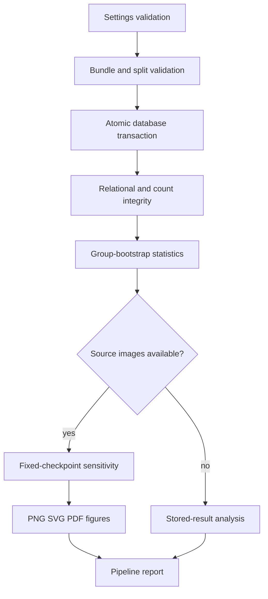

# System architecture

RMLDNet separates five concerns: source data, perception computation, experiment outputs, durable experiment management, and analysis. Images and masks stay in external data directories. Portable manifests identify their paths and hashes. Models produce predictions and counts; complete experiment bundles contain configurations, selected checkpoints, aggregate results, per-image observations and artifact files.

`storage.validation` validates the entire bundle before writing. `ExperimentStore` wraps all dataset/run inserts in one SQLite transaction. The metrics view derives numerical scores from counts. `analysis` reads the registry to bootstrap source groups and uses a fixed delivered checkpoint for sensitivity experiments. `pipeline` coordinates these modules and writes a complete machine-readable execution record.

A separate model workflow handles training and inference. Neural training is not triggered by database ingestion. Default management commands neither redownload datasets nor retrain models. Explicit training, download and sensitivity commands are available for reproducibility.

Failures in source validation prevent a transaction. Constraint failures roll back the entire import. Destination files are never silently overwritten by backup or portable export. Database errors do not alter source bundles. Logs report operation counts and failures without dumping process environments or credential files.

The initial schema version is 1. Unknown versions are rejected. SQLite is optimized for a local workstation; high-concurrency distributed ingestion should use a dedicated service and transactional server database.
