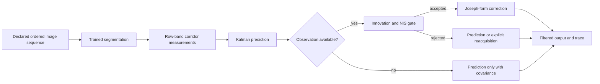

# Lane measurements and Kalman filtering

## What is implemented

`rmldnet.kalman.LinearKalmanFilter` implements a validated linear Gaussian prediction/update kernel. `LanePositionFilter` configures that kernel for two mask-derived corridor-center observations. `geometry.extract_corridor` supplies the observations, and `temporal.run_sequence` integrates trained image segmentation, measurement extraction and filtering. The existing multi-lane `LaneTracker` now also uses the same linear kernel, preserving its separate cubic-geometry state and Hungarian association.

The two tracking paths solve different input problems: instance-supervised lane embeddings support individual lane tracks; semantic-only masks can supply a conservative camera-center corridor proxy. No lane instance identities are invented from VIA semantic classes.

## Measurement extraction

For each image, the trained segmentation model outputs foreground probabilities. The frozen validation-selected threshold creates a binary mask. At normalized image rows y=0.85 (near) and y=0.60 (far), a five-row band is examined. Each row is split into contiguous foreground runs. Runs wider than 0.15 image widths are rejected. The closest run on each side of the image center defines a candidate corridor if its width lies in [0.12, 0.98]. At least two valid rows are required; the band median gives the center.

The observation is `z=[c_near,c_far]`. Coordinates are normalized horizontal image positions, not meters, road curvature, vehicle pose, or an identified ego-lane. Missing bracketing marks produce a missing observation, not an interpolated annotation. The same extractor applied to reference masks defines a descriptive geometry comparison, not independently calibrated vehicle-position truth.

## State, transition, and measurement model

The state is

$$x_k=[c_{near},c_{far},v_{near},v_{far}]^T.$$

Centers use normalized image width; velocities use normalized width per second. For elapsed time Δt:

$$F_k=\begin{bmatrix}1&0&\Delta t&0\\0&1&0&\Delta t\\0&0&1&0\\0&0&0&1\end{bmatrix},\quad H=\begin{bmatrix}1&0&0&0\\0&1&0&0\end{bmatrix}.$$

The model assumes approximately constant image-coordinate velocity over one sampling interval. It is not a calibrated vehicle motion model. The generic filter optionally accepts a control matrix B and input u; this lane configuration uses no external control, so Bu=0.

A discrete independent acceleration per interval gives

$$G_k=\begin{bmatrix}\frac{\Delta t^2}{2}&0\\0&\frac{\Delta t^2}{2}\\\Delta t&0\\0&\Delta t\end{bmatrix},\qquad Q_k=qG_kG_k^T.$$

This is a discrete random-acceleration model, not the continuous white-acceleration spectral-density formula. The default acceleration variance is q=0.0004. Measurement covariance is R=0.000144 I, corresponding to a normalized-width standard deviation of 0.012 in the numerical experiments. These defaults are not empirical noise calibration for real driving cameras.

Initialization requires five consecutive complete observations whose per-anchor ranges are at most 0.06 normalized widths. Position uses the window median; velocity is zero with variance 0.01. Initial position covariance is conservatively set to R rather than treating the correlated window as independent measurements. At 10 Hz the window introduces at least 0.4 s of startup delay and a median-window lag. During unstable startup the output is explicitly unavailable. Setting `initialization_observations=1` restores immediate single-observation initialization for controlled comparisons. The retained failures demonstrate why one observation is insufficient under initial outliers.

## Prediction and correction

The prediction equations are

$$\hat x_{k|k-1}=F_k\hat x_{k-1|k-1}+B_ku_k,$$

$$P_{k|k-1}=F_kP_{k-1|k-1}F_k^T+Q_k.$$

With innovation ν and innovation covariance S:

$$\nu_k=z_k-H_k\hat x_{k|k-1},\qquad S_k=H_kP_{k|k-1}H_k^T+R_k,$$

$$K_k=P_{k|k-1}H_k^TS_k^{-1},$$

$$\hat x_{k|k}=\hat x_{k|k-1}+K_k\nu_k.$$

The implementation solves linear systems rather than explicitly forming the inverse. A Cholesky factor of S computes the normalized innovation squared, NIS=νᵀS⁻¹ν. With the default gate, a candidate linear update is rejected if NIS>9.21. This corresponds to a 99% chi-square cutoff for a two-dimensional Gaussian innovation; the same configurable cutoff is conservative for partial one-dimensional observations. It is not a guarantee under model mismatch or outliers.

The simple covariance subtraction `(I−KH)P` is algebraically equivalent under exact arithmetic, but the implementation uses the Joseph form:

$$P_{k|k}=(I-K_kH_k)P_{k|k-1}(I-K_kH_k)^T+K_kR_kK_k^T.$$

P is symmetrized and checked for finite values and positive semidefiniteness within numerical tolerance. State dimensions, matrix shapes, finite inputs, symmetric covariances, positive-definite R, control dimensions and timestamps are validated. An invalid innovation covariance raises an error rather than silently applying a pseudoinverse or changing noise values.

If only one center is available, corresponding rows of H and R are selected. With no observation, only prediction is performed and uncertainty grows. Filter state is reset between sequences.

## Lost-track reacquisition: separate from the Kalman equations

Development seed 24 began with a large outlier. Subsequent gating rejected correct observations, and a later correction produced a wrong velocity that locked the track away from the observations. The original result and trajectory are retained, including its large error.

The wrapper now monitors consecutive full observations rejected by the linear update. If eight such observations each span at most 0.06 normalized widths across the window, it explicitly reacquires from their median, resets velocity to zero and resets covariance to the initialization values. Missing, partial or accepted observations clear the candidate window. This is a heuristic mode switch, not a Gaussian posterior update. The output marks `status="reacquired"` and retains the failed innovation/gating result; it does not mislabel that result as an accepted linear correction.

The recovery rule was added using development seeds 7–26. An additional forced-initial-outlier test on seeds 107–126 showed that recovery alone retained substantial startup error; that intermediate result is also saved. Stable-window initialization was then added before the final separate verification seeds 207–226 were evaluated, both with ordinary stress and with forced initial outliers. A coherent false boundary can still trigger a false reacquisition; real-video calibration and failure analysis remain necessary. Set `initialization_observations: 1` and `reacquire_after: null` to reproduce the retained initial failure. Set only `initialization_observations: 1` to reproduce the intermediate recovery-only variant. Rapidly changing or missing boundaries can delay initialization indefinitely; absence of an estimate must not be interpreted as correct tracking.

## Configuration and executable use

All wrapper and row-band parameters are listed in `configs/temporal.yaml`.

```bash
python -m rmldnet.temporal --render-demo --output runs/controlled_sequence
python -m rmldnet.temporal --manifest /path/to/verified_sequence.json --config configs/temporal.yaml --output runs/video_track
```

The controlled render is explicitly synthetic. A user-supplied sequence manifest has this structure:

```json
{
  "sequence_id": "camera-sequence-01",
  "source_kind": "verified_video",
  "frames": [
    {"image": "frames/0001.png", "timestamp_s": 0.0},
    {"image": "frames/0002.png", "timestamp_s": 0.1}
  ]
}
```

Paths are relative to the manifest. Timestamps must increase strictly. `source_kind` must explicitly be `verified_video` or `synthetic_controlled`. This is a caller assertion, not automatic proof of temporal provenance. A standard VIA dataset manifest is deliberately rejected; frame ordering is never inferred from filenames.

The output `sequence.json` contains raw measurements, candidate priors, posterior states, covariance matrices, gains, NIS, rejection/reacquisition flags and source kind. The library uses normalized image coordinates throughout.



## Evidence and interpretation

See `results/extensions/README.md` for actual numerical results and seven additional figures. The nominal and stress trajectories are synthetic; the geometry and confidence studies use independent held-out images. Real temporal tracking accuracy is not claimed because verified sequential ground truth is unavailable. A smoother trace alone is not proof of accuracy: the tests and numerical experiments compare estimates against known synthetic truth and retain the failed initial implementation.
