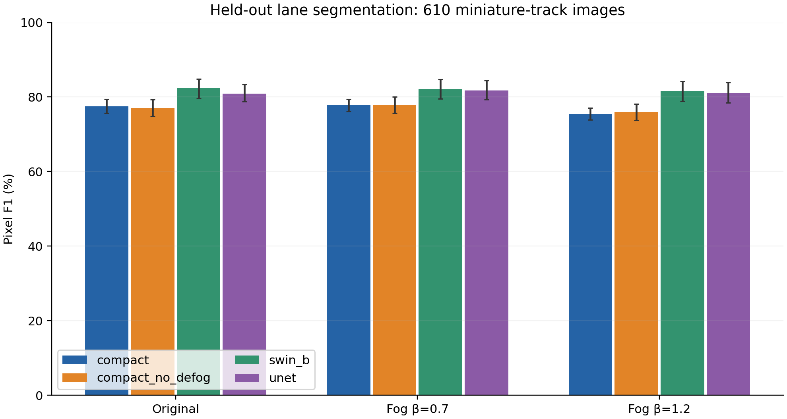
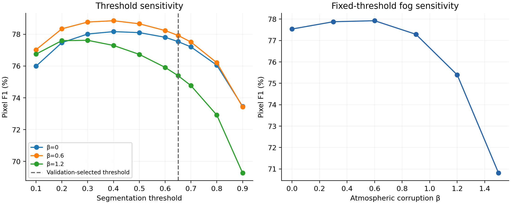
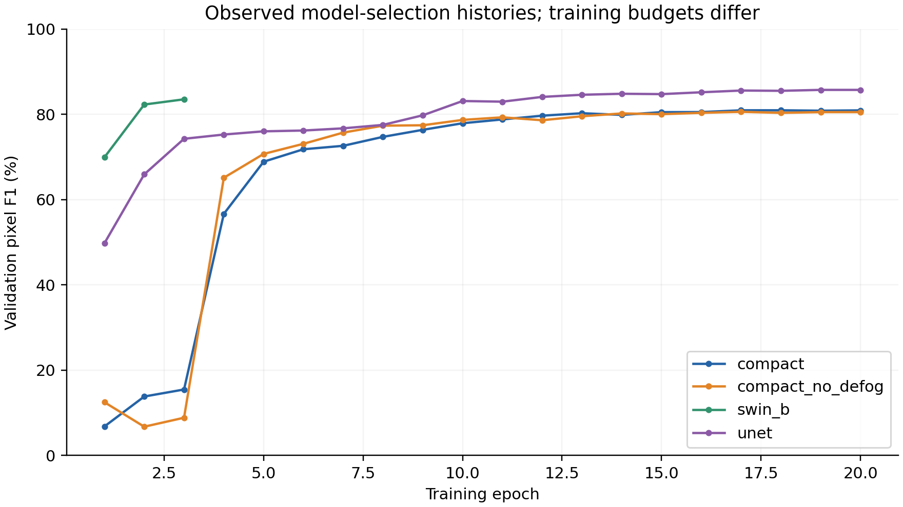

# Statistical and sensitivity analysis

All figures and tables are computed from actual recorded results or new fixed-checkpoint executions.

## Group-bootstrap uncertainty

2,000 percentile bootstrap resamples, seed 7, 13 source filename groups. Values below are pixel F1 percentages.

| Model | Fog β | F1 | 95% lower | 95% upper |
|---|---:|---:|---:|---:|
| compact | 0.0 | 77.54 | 75.67 | 79.40 |
| compact | 0.7 | 77.80 | 76.13 | 79.47 |
| compact | 1.2 | 75.39 | 73.85 | 77.11 |
| compact_no_defog | 0.0 | 77.06 | 74.86 | 79.26 |
| compact_no_defog | 0.7 | 77.90 | 75.72 | 80.05 |
| compact_no_defog | 1.2 | 75.87 | 73.74 | 78.08 |
| swin_b | 0.0 | 82.34 | 79.67 | 84.85 |
| swin_b | 0.7 | 82.17 | 79.52 | 84.70 |
| swin_b | 1.2 | 81.66 | 78.84 | 84.16 |
| unet | 0.0 | 80.94 | 78.72 | 83.32 |
| unet | 0.7 | 81.76 | 79.31 | 84.40 |
| unet | 1.2 | 81.03 | 78.42 | 83.89 |

The paired original-image difference (Swin-B minus U-Net) is 1.40 percentage points, with a 95% interval [-0.33, 2.75]. The interval includes zero; these data do not establish a reliable superiority claim.

Filename groups approximate local dependence but are not verified independent drives. These intervals do not cover uncertainty from retraining with different seeds or generalization to full-size roads.

## Threshold and fog sensitivity

The delivered compact checkpoint was executed on all 610 held-out images under β=0, 0.3, 0.6, 0.9, 1.2 and 1.5. Ten thresholds were evaluated from the resulting probability maps. The selected checkpoint and validation-selected threshold were kept fixed. This descriptive sweep is not a new model-selection procedure.

The fixed-threshold β=0 and β=1.2 confusion matrices exactly match the previously evaluated checkpoint results. See `sensitivity.csv` and `sensitivity.json` for counts; `statistics.csv` and `statistics.json` contain bootstrap summaries.

## Figures

*Pixel F1 and source-group bootstrap intervals across the three recorded test conditions.*

*Descriptive threshold sensitivity and fixed-threshold atmospheric-corruption sensitivity.*

*Observed validation histories; budgets and initialization differ across architectures.*

All three figures are also available as vector SVG and PDF in `results/figures/`.
