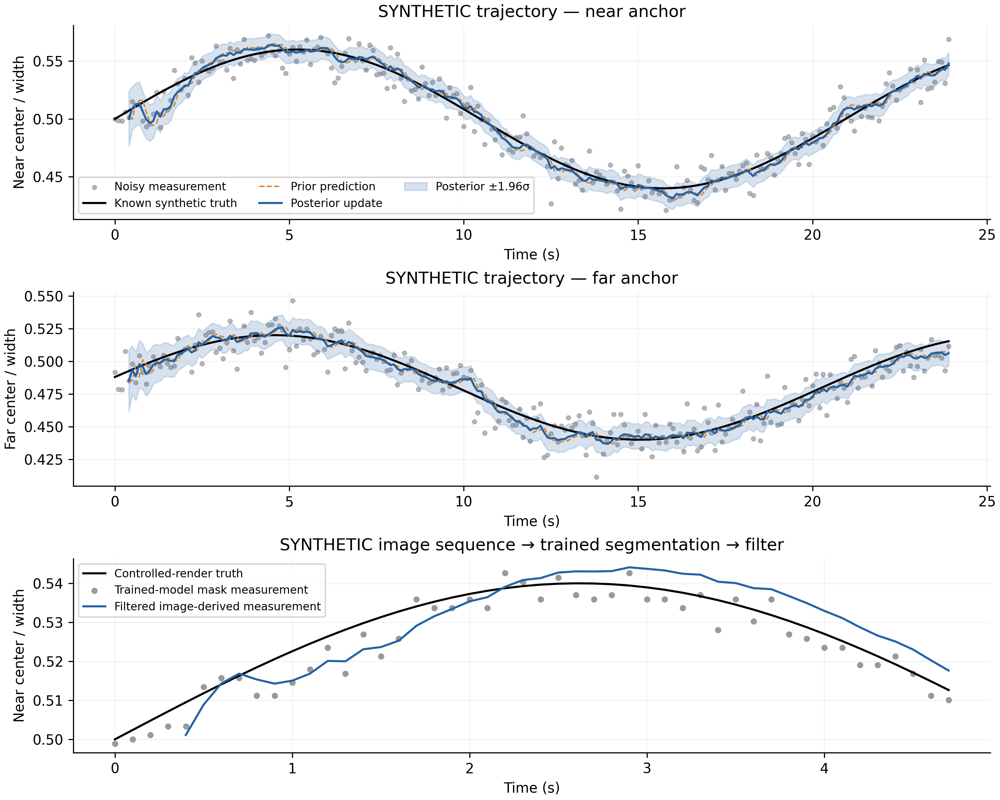
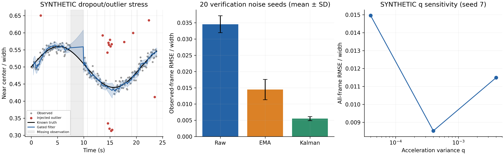
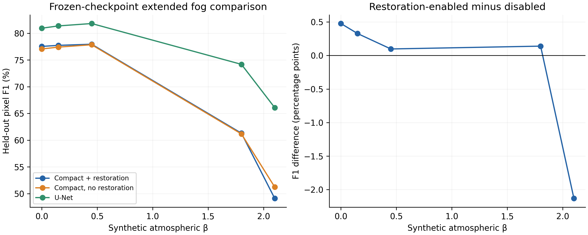
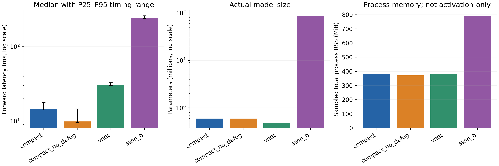
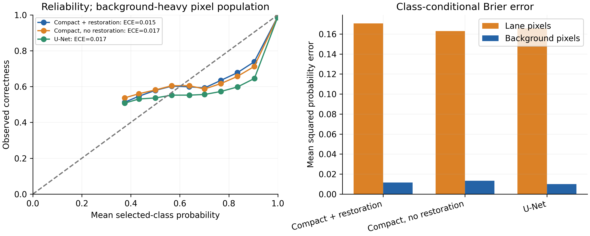
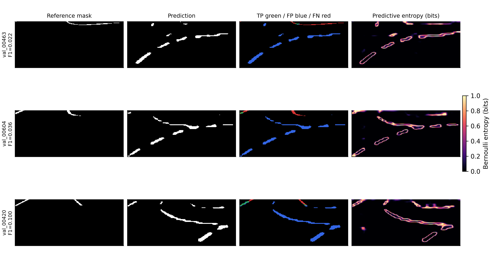
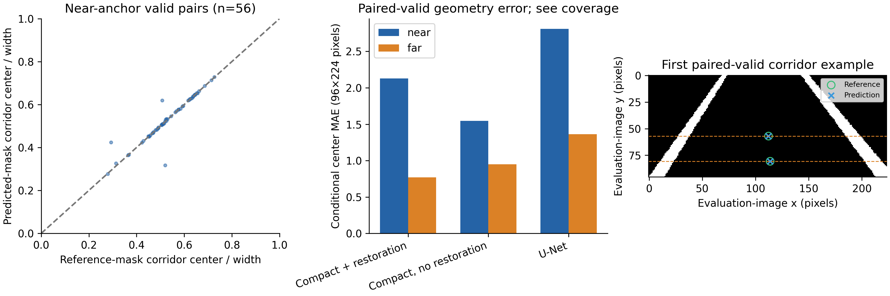

# Additional experiments: filtering, robustness and diagnostics

Original verified outputs remain in `results/via` and `results/analysis`; these new experiments are separate. None of the VIA filenames are treated as consecutive driving frames.

## 1. Synthetic nominal filtering

Two analytic normalized-image corridor centers are observed at 10 Hz for 240 steps, with Gaussian measurement standard deviation 0.012. Development noise seeds 7–26 and separate verification seeds 207–226 are evaluated. Summary errors below use the verification set and exclude the first 10 steps. Q/R are specified by the simulation; the wrapper recovery rule was fixed before verification.

Mean observed-frame RMSE: raw **0.011947**, Kalman **0.004861**, EMA **0.005691**, in normalized image width.



*First two panels: known analytic truth, noisy observations, prior predictions, posterior corrections and posterior ±1.96σ for seed 7. Third panel: actual trained-model measurements and filtered estimates from the controlled image sequence. Initial estimates are withheld during the five-observation startup window. All three panels are synthetic, not vehicle motion measurements.*

## 2. Synthetic temporal stress and parameter sensitivity

The stress case adds a 25-frame contiguous gap, random missing observations, and injected outliers. Across the 20 verification noise seeds, observed-frame RMSE is **0.034545** raw and **0.005510** filtered. Initialized-frame filtered RMSE, including gaps, is **0.006867**. Mean nominal posterior interval coverage is **95.80%**; coverage is diagnostic, not a guarantee.



*Seed-7 stress trajectory, mean ± SD observed-frame RMSE across 20 verification noise seeds, and a predeclared three-value acceleration-noise sweep. EMA uses α=0.25; filtering is causal.*

During development, a first-observation outlier in seed 24 produced gate lock: valid updates were rejected after a biased velocity estimate. Its original observed-frame filter RMSE was 2.152787 normalized widths. The failed outputs are retained as `kalman/initial_stress_results.json` and `kalman/initial_failure_trajectory.json`. The wrapper now initializes only after five coherent complete observations (at least 0.4 s at 10 Hz) and reacquires from the median of eight consecutive rejected, full observations only when each anchor range is at most 0.06; it resets velocity and covariance explicitly. This heuristic is separate from the linear Kalman update and can still fail on coherent false boundaries.

The final stable-initialization seed-24 RMSE is 0.006280. Independent verification seeds 207–226 were evaluated after the recovery rule was fixed. The failed run can be reproduced with `initialization_observations=1` and `reacquire_after=None`.

The intermediate reacquisition-only variant is retained in `kalman/reacquisition_only_results.json`. On its additional forced-initial-outlier verification using seeds 107–126, mean filtered RMSE was 0.035101 versus 0.033998 raw: recovery alone did not fix startup bias. Stable-window initialization was added before the final verification seeds 207–226 were evaluated.

On the final forced-initialization verification, mean filtered RMSE is 0.005542. Availability counts are saved: frames without a valid initialized state are not filled or treated as accurate predictions.

A separate 48-frame controlled render executes the complete trained-model → measurement → filter pipeline. See `temporal/sequence.json`; it is explicitly `synthetic_controlled`.

Controlled-image matched-frame RMSE is 0.004387 raw versus 0.004026 filtered, with 44 scored frames out of 48. The fixed simulation noise settings are not calibrated to this renderer or model; smoothing can introduce lag and need not improve image-derived accuracy.

## 3. New fog levels and restoration comparison

Frozen compact, no-restoration and U-Net checkpoints are evaluated on all 610 held-out miniature-track images. New atmospheric β levels are 0.15, 0.45, 1.8 and 2.1; β=0 is repeated solely to verify the original confusion matrices and provide a reference. Thresholds are unchanged and not selected from test data.

| Model | β=0 F1 (%) | β=0.15 | β=0.45 | β=1.8 | β=2.1 |
|---|---:|---:|---:|---:|---:|
| compact | 77.54 | 77.73 | 77.95 | 61.31 | 49.12 |
| compact_no_defog | 77.06 | 77.41 | 77.85 | 61.17 | 51.25 |
| unet | 80.94 | 81.37 | 81.82 | 74.18 | 66.09 |



*Pixel F1 and restoration-enabled minus disabled differences. Independent training initialization/augmentation histories and the restoration pretraining budget prevent a causal claim that restoration alone explains differences.*

## 4. Controlled CPU efficiency

Models are benchmarked serially in fresh subprocesses on an identical SHA-256-verified synthetic 96×224 RGB probe, batch 1, two CPU threads, 5 warmups, and 3×30 timed forwards. Input generation, loading and postprocessing are excluded. Memory polling is sampled total resident process memory, not activation-only or GPU memory.

| Model | Parameters | Median forward ms | P95 ms | Sampled process RSS MiB |
|---|---:|---:|---:|---:|
| compact | 595,959 | 14.482 | 17.679 | 380.3 |
| compact_no_defog | 593,123 | 9.910 | 14.607 | 371.2 |
| unet | 487,297 | 30.402 | 32.745 | 379.5 |
| swin_b | 87,079,889 | 243.729 | 258.729 | 790.3 |



*Actual timing distributions, parameter counts and sampled process resident memory. These observations are machine-specific, not real-time vehicle-deployment claims.*

## 5. Confidence and error diagnostics

Calibration uses probability assigned to the class selected by the frozen validation threshold. Fifteen equal-width bins produce weighted ECE; Brier/NLL use all pixels. Class-conditional Brier errors expose background imbalance. Predictive entropy is not Bayesian or epistemic uncertainty.

| Model | Brier | NLL | ECE | Lane Brier | Background Brier |
|---|---:|---:|---:|---:|---:|
| compact | 0.02097 | 0.09086 | 0.01547 | 0.17058 | 0.01158 |
| compact_no_defog | 0.02212 | 0.09635 | 0.01714 | 0.16284 | 0.01328 |
| unet | 0.01921 | 0.09271 | 0.01669 | 0.16566 | 0.01001 |



*Selected-class reliability and true-class-conditional squared probability errors; the population is background-heavy.*



*The three lowest finite per-image F1 scores for the compact checkpoint on original held-out images, with ID tie-breaking. This is an explicit worst-case selection rule. Color errors and entropy are computed from the saved predictions. Source photographs are excluded.*

## 6. Image-derived lane geometry

Near/far row bands at y=0.85/0.60 extract the nearest narrow foreground runs bracketing the camera center. Missing, merged or unbracketed markings produce no estimate. Reference geometry is extracted from annotated masks using the same rule; it is a mask-consistency proxy, not calibrated ego-lane ground truth. Errors are conditional on both reference and predicted centers being available; coverage is reported explicitly.

| Model | Anchor | Valid pairs / reference available | Conditional MAE (evaluation pixels) |
|---|---|---:|---:|
| compact | near | 56 / 64 | 2.129 |
| compact | far | 166 / 178 | 0.771 |
| compact_no_defog | near | 58 / 64 | 1.547 |
| compact_no_defog | far | 170 / 178 | 0.948 |
| unet | near | 54 / 64 | 2.810 |
| unet | far | 152 / 178 | 1.362 |



*Paired center scatter, conditional mean errors, and the first paired-valid compact example. Coverage and failures limit interpretation; unknown centers are never filled using annotations.*

## Reproduce

From the repository root, after installing the environment and preparing `data/via`:

```bash
python -m rmldnet.extensions all --output runs/extensions --full-checkpoint runs/via/swin_b/best.pt
```

The full Swin-B trained checkpoint is regenerated using the existing training instructions. Individual commands `kalman`, `robustness`, `efficiency`, and `figures` are also supported. No original result files are overwritten by these commands.

The additional segmentation bundle is compatible with the existing transactional registry. New filtering/geometry diagnostics remain explicit JSON/CSV records rather than being mislabeled as pixel-confusion experiments. PNG, SVG and PDF exports share the same computed data.
